<picture>
  <source media="(prefers-color-scheme: dark)" srcset="./assets/kyo-banner-dark.svg">
  
</picture>

Frontend engineer working alongside coding agents. They write the code; I decide what the screen should be and make sure it's right.

I have a thing for coding harnesses.

### What I care about

- deciding what a screen should be before anyone writes code
- interfaces that make an agent's work easy to read
- knowing when to let the agent run and when to step in
